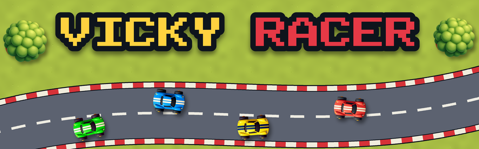

# Vicky Racer

<!-- This file mirrors docs/itch/description.html (the itch.io page text). Whenever that file changes, update this one to match. -->

**A cheerful top-down racing game made for little drivers, and fun for the grown-ups racing next to them.**

Vicky Racer started as a game for one small boy who loves cars. Pick a toy car, a boat or a spaceship, race three friendly opponents around bright, chunky tracks, slide through the corners and collect coins to buy new rides. There's no crashing, no spinning out and no "you lose" screen. Every finish is celebrated.

## New: a whole world to drive around

Press **PLAY** and you're straight in the car in town. There are no menus to get through: every race starts where it's parked. Drive up to a race gate, and the three friends waiting on the grid are ready when you are. The garage, the trophy house, the stadium, the workshop and the rocket pad are all buildings you can drive into.

- **Six places to explore over the bridges:** a **snowy hill** to sledge down, **candy land** with bouncy jelly pads and a chocolate lake, a **jungle** with an old temple and mud that keeps your car dirty until the car wash, **toy town** on a giant play mat with a toy train going round, **Sunny Beach** with waves that push you up the sand, sandcastles to knock down and crabs that run away, and the **ring road** round town with a tunnel that echoes when you honk, a stream, a fuel station and a sign that shows how fast you're going.
- **Get out and walk:** press **E** to climb out of the car. Pet the dogs and cats, borrow a car from a driveway, and press **E** again to get back in.
- **Things to do everywhere:** 80 golden stars hidden around the world, a jobs board with little tasks for the day, street races, stopwatch time trials, jump ramps, a drift zone, playground rides, and fireworks at night.
- **A map in the pause menu** shows every place. Pick one and an arrow points the way.
- **Night races:** press the moon button on the title, or **N** (a gamepad's **Back**), and every car switches on its headlights.

## Made for small hands

- **You can't spin out.** The car always points where you steer. Walls slide you along instead of stopping you, and driving on the grass only slows you down.
- **Easy to read without reading.** Big numbers for your place and lap, bars instead of stats, and a camera that never rotates.
- **Driving helps for the very young.** Turn on **AUTO GO** so the car drives itself forward and your child only steers, and **STEER HELP** for a gentle nudge back towards the road.
- **Three opponent speeds.** Easy, Normal or Fast, so you can set how hard it is to win.
- **Hard to quit by accident.** In a race, Escape pauses instead of leaving.

## What's inside

- **Cars, boats and spaceships:** three ways to race, each with its own garage, courses and cup.
- **7 car tracks:** Meadow Loop, Sunny Beach, Snowy Peak (with slippery ice), Toy Town, Jungle Run, Candy Lane and Moon Base, complete with bridges and boost pads.
- **4 water courses:** Duck Pond, Jungle River, Pirate Cove and Lemonade Lake, with ramps, currents, logs and shortcuts.
- **4 space courses:** Asteroid Alley, Ring Road, Nebula Station and Candy Galaxy, with drifting asteroids, comets and floaty, slidey ships.
- **31 rides to collect:** 13 cars (a sports car, an ice-cream van, a monster truck, a dragon, a soapbox and more), 9 boats (a rubber duck, a pirate ship, a swan pedalo...) and 9 spaceships (a flying saucer, a space taxi, a teacup saucer...). Each handles differently, Vicky and his friends ride along where you can see them, and you can paint every one for free.
- **Weather:** sometimes a shower rolls in mid-race, with slippery puddles on the road and a rainbow afterwards. On Snowy Peak it snows.
- **Build your own tracks:** tap dots to lay out a road, add trees, puddles and boost pads, pick a theme and race it straight away. Crossings turn into bridges by themselves. Tracks save on their own and can be shared as a small file with friends.
- **Drifting:** hold the handbrake to kick the tail out and slide around corners.
- **5 cups:** three races in a row, points after each race and a podium at the end, with gold, silver and bronze trophies.
- **Trophy shelf and stickers:** a sticker book to fill and trophies to collect.
- **2 players on one screen:** split screen for racing with a parent or sibling. Two gamepads, a gamepad and a keyboard, or one keyboard shared.
- **Time trial with ghosts:** race your own best lap, and try to beat the gold ghost on every track.
- **An island town to explore:** no race, no clock. Cruise past the candy shop, the ice cream parlour, the toy shop and the fire station while buses and cars go about their day, dogs and cats walk the pavements and duck families waddle across the zebra crossings. Score goals with the football, jump the ramps, deliver pizza, find the lost puppy, put out bonfires with the fire engine, drive the school bus full of animals, change your paint at the paint shop, and take it through the car wash until it sparkles. Drive onto the harbour pier and your car turns into a boat, so you can sail round the island past the lighthouse, the dolphins and the sailboats.
- **Cheerful music** and toy-like sound effects.

## Controls

| | Keyboard | Gamepad |
|---|---|---|
| Steer | ← → or A D | Left stick |
| Accelerate | ↑ or W | RT or A |
| Brake / reverse | ↓ or S | LT or B |
| Drift (handbrake) | Space | X |
| Horn | H | Y |
| Get out / get in | E | Y |
| Day / night | N | Back |
| Pause | Esc | Start |

Every menu works with a gamepad alone.

## How it was made

Built in Godot 4.7. The art, sound effects and music were generated locally with AI tools (ComfyUI and Stable Audio), then picked and polished by hand.
